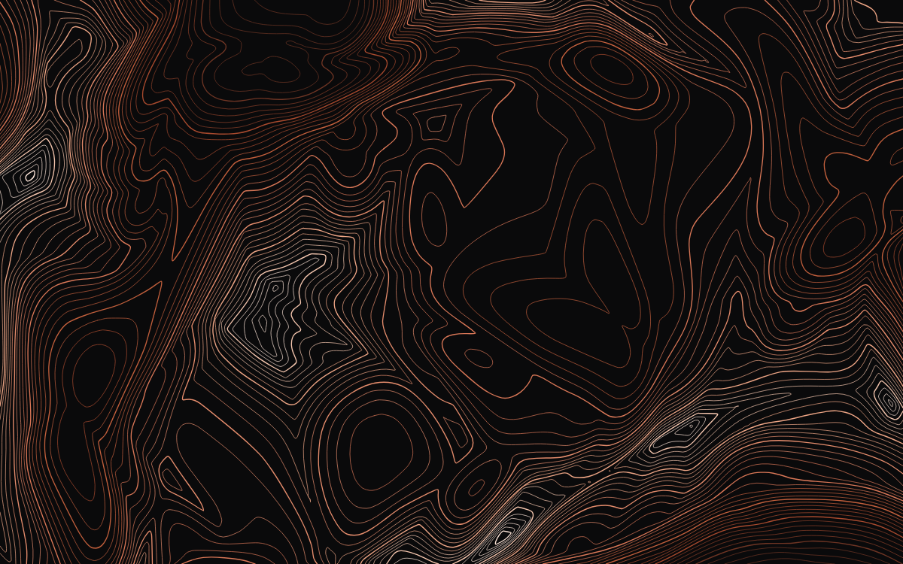

# Claude Topo

A theme for Claude: topographic contour art on a black background. Claude-orange lines trace the elevation "highs and lows of an imaginary landscape. The lines pack tight and burn pale peach on steep peaks, and spread wide in deep rust across valleys and plains. Every fifth line is a heavier index contour, as on a survey map.



It themes the Claude desktop and mobile apps (colours, accents and the backdrop). The terminal draws no theme, so nothing changes there. It's dark-only: the map is drawn on black.

**Needs Claude Code v2.1.324 or later.**

## Install

In the Claude desktop app: click **+** next to the prompt box, then **Plugins**, **Add marketplace** with `fierybeing/claude-topo`, then **Add plugin**.

Or from a shell:

```bash
claude plugin install claude-topo --marketplace fierybeing/claude-topo
```

Start a new session and the theme paints.

## Update

```bash
claude plugin marketplace update claude-topo
```

```bash
claude plugin update claude-topo@claude-topo
```

## If the theme doesn't show up

- **Start a new session.** A session keeps the look it started with.
- **Turn off other themes.** Only one theme can stand per session. Disable others in **+** → **Plugins**.
- **Update Claude.** Older versions install the plugin and paint nothing.

## Make it yours

The landscape is generated. For a different one, run the generator with any number as the seed:

```bash
node tools/gen.js 42
```

It rewrites `hooks/scene.ts` and writes a preview to `tools/prototype.html`. The knobs at the top of `tools/gen.js` set the number of contour lines, how much of the map is mountains versus plains, feature size, and the colour ramp from low ground to summit. App colours are in `hooks/register.tsx`.

## Credits

Based on [Holo Damascus](https://github.com/bassonrichard/holo-damascus) by Richard Basson. MIT licence. `hooks/make-colors.js` and `hooks/make-colors.d.ts` come from Claude Code's plugin authoring kit.
