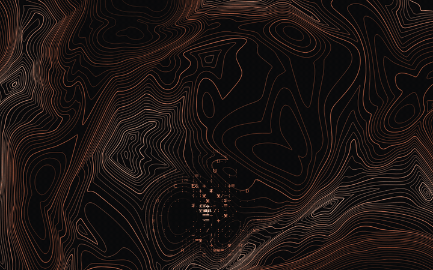

# Ember Topo

A theme for Claude: topographic contour art on a black background. Claude-orange lines trace the elevation "highs and lows" of an imaginary landscape. The lines are closely spaced and burn pale peach on steep peaks, and spread wide in deep rust across valleys and plains. Every fifth line is a heavier index contour, as on a survey map.


## The ASCII spirit

On the desktop app, a little spirit wanders the map in loose, squiggly loops, and the contour lines it passes turn into ASCII. Each stretch of line becomes the character shaped most like it: a line low in its cell becomes `_`, a slope `/` or `\\`, a steep one `|`, stacked lines `=`, a bend `(` or `)`, a little ring on a peak `o`, a line just grazing `.` or `,`. The bare ground stays bare, so there's no grid. The lines dissolve into type cell by cell, and the spirit leaves a long, wide wake that slowly turns back into lines. Move your pointer over the background and it stirs the map the same way.



It runs as a GPU shader (`hooks/spirit.ts`). The mobile app, Reduce Motion, and machines that can't run it show the still map. The knobs at the top of `hooks/spirit.ts` set its reach, how wide it loops, how long its wake lingers, and the character cell size. The character shapes live in `tools/font.js`; after changing them, run `node tools/match.js` to rebuild the matcher in `hooks/spirit.ts`.

It themes the Claude desktop and mobile apps (colours, accents and the backdrop). The terminal draws no theme, so nothing changes there. It's dark-only: the map is drawn on black.

**Needs Claude Code v2.1.324 or later.**

## Install

In the Claude desktop app: click **+** next to the prompt box, then **Plugins**, **Add marketplace** with `fierybeing/claude-topo`, then **Add plugin** (it's listed as **ember-topo**).

Or from a shell:

```bash
claude plugin install ember-topo --marketplace fierybeing/claude-topo
```

Start a new session and the theme paints.

## Update

```bash
claude plugin marketplace update ember-topo
```

```bash
claude plugin update ember-topo@ember-topo
```

## If the theme doesn't show up

- **Start a new session.** A session keeps the look it started with.
- **Turn off other themes.** Only one theme can stand per session. Disable others in **+** → **Plugins**.
- **Update Claude.** Older versions install the plugin and paint nothing.

## Make it yours

The landscape is generated. For a different one, run the generator with any number as the seed:

```bash
node tools/gen.js 42
```

It rewrites `hooks/scene.ts` and writes a preview to `tools/prototype.html`. The knobs at the top of `tools/gen.js` set the number of contour lines, how much of the map is mountains versus plains, feature size, and the colour ramp from low ground to summit. App colours are in `hooks/register.tsx`.

## Credits

Based on [Holo Damascus](https://github.com/bassonrichard/holo-damascus) by Richard Basson. MIT licence. `hooks/make-colors.js` and `hooks/make-colors.d.ts` come from Claude Code's plugin authoring kit.
